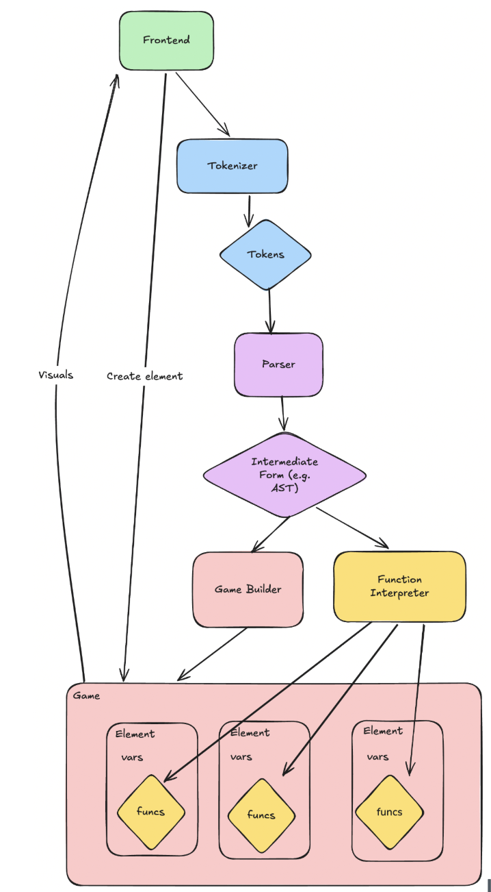

# Check-in 1:
Description of planned DSL:
- What is the high-level purpose of your DSL? What will it enable users to do?
    - Build out a game with interactable elements based on the game https://dan-ball.jp/en/javagame/dust/
    - Users should be able to define results of interactions
    - Define actual elements/types
    - Given base level elements, all users can edit and interact with them
- What kind of users is it aimed at? 
    - Creative users
    - Minecraft-type gamers
    - Sim gamers
    - Kids interested in learning to program
- What are the key richer features of your DSL? 
    - Conditionals - Define how elements interact; example: if wood touches fire…
    - Mutable variables - Editing/modifying the different elements; example: specifying the rate at which ice melts into water when near heat sources
    - Classes/Inheritance
        - Define elements that share properties; example: air and poison gas inherit from gases 
    - Functions
        - Reusable code, used in classes; example: users can define a function melt that turns solid elements into liquid ones
    - Loops
        - Allows users to iterate through nearby elements 
- Which features can be combined to interact in useful or creative ways?
    - All of them, since the DSL is inherently designed for people to be creative
    - Example: Functions can use mutable variables and conditionals to alter the state of elements

<br>

Example snippets of your DSL that illustrate at least each rich feature, and any interesting interaction between those:

```
template-element Element:
    has position-x with 0
    has position-y with 0
    has color

    has function tick

    has function is-there-something-below:
        let elements be get-all-elements() # probably language-implemented function

        for-every element in elements:
            if (element.position-y - 1) equals position-y:
                give true

        give false

template-element Solid is like Element:
    has function tick:
        fall()

    has function fall:
        bool something-is-below = is-there-something-below()

        if not something-is-below:
            let position-y be position-y - 1

function flow needs element:
    # do something with element that makes it flow properly with other liquids here
    do-nothing

template-element Liquid is like Element:
    has function tick:
        flow()

template-element Gas is like Element:
    has function tick:
        do-nothing

template-element Energy is like Element:
    has intensity = 10

    has function tick:
        if intensity greater-than 0:
            let intensity be intensity - 1
        else
            disappear()

element Water is like Liquid:
    let color be Color.blue

element Lava is like Liquid:
    let color be Color.red

element Stone is like Solid:
    let color be Color.grey

element Ice is like Solid:
    let color be Color.light-blue
    let health be 50
    let melting-speed be 2

    has function tick:
        parent()

        let elements-in-range be get-elements-in-range(5)

        for-every element in elements-in-range:
            if element is Lava or element is Fire:
                let health be health - melting-speed

        if health equals 0:
            convert-to(Water)

element Fire is like Energy:
    let color be Color.orange

```

<br>

What plans have your team made for collaboration (timing of work, communication, meetings/tools used, etc.):
- Make plans and discuss via Discord
- Use google forms and polling sites to vote on ideas
- Conduct in person meetings on Mondays at 2PM

<br>

Note any planned follow-up tasks or features still to design:
1. Come up with a proper concrete syntax for the language
2. Plan the modules and provision work:
    - Physics engine
    - Entities
    - Interpreter
    - Parser
3. Plan User Stories

<br>
TA Notes:
- Make sure that users are able to code an unbounded number of elements and interactions programatically

<br>

# Check-in 2: 
Planned division of main responsibilities between team members, considering how to enable working in parallel as much as possible. Consider the following points:
- Modular design for the software system: what is the input, output of each component? Who is responsible for each component? Do you want to be jointly responsible for some components? 
    - See below table.
- What is the data at each interface point? Are there invariants over the data other than the class structure? 
    - Text, Tokens, AST, Typescript
- How will you be able to build component X independently? Can you write tests for component X independently of its dependent components?
    - Split components into individual modules.
- Who will be responsible for writing which tests, and when (will the same people write the tests as the code)? 
    - Each person writes tests for their own module. They will write tests after the code.
- Are there design or other project tasks (possibly including team management), other than these components, that need to be assigned/completed?
    - Syntax and AST design needs to be flushed out.

Work Split:
| **Task**                     | **Assigned people** |
| ---------------------------- | ------------------- |
| Frontend (UI, orchestration) | Harper              |
| Tokenization                 | Alyson              |
| Parsing                      | Alyson              |
| Interpreter                  | Jake                |
| Game Builder                 | Stanley, Terence    |



Other Tasks:
| **Task**                     | **Assigned people** |
| ---------------------------- | ------------------- |
| Submit checkins to repo      | Alyson              |
| Set up repo                  | Harper              |
| Video Presentation           | Harper              |


Roadmap/timeline(s) for what should be done when, and how you will synchronise/check-in with each other to make sure progress is on-track. Talk clearly with your team members about your expectations for communication and progress, and what you will do as a team if someone falls behind.
- Synchronisation will happen during the weekly meetings on Monday at 2pm. If urgent, check-ins can happen via Discord.

| **Date/time**      | **Item**               |
|--------------------|------------------------|
| Sep 25 at 5:00pm   | Project 1 Check-in 2   |
| Sep 25 at 1:00 pm  | Finalize Language Spec |
| Sep 27th           | Set up repo            |
| Sep 28th           | AST Definition         |
| Sep 28th           | Plan first user study  |
| Oct 2 at 5:00pm    | Project 1 Check-in 3   |
| Oct 5              | Plan final user study  |
| Oct 9 at 5:00pm    | Project 1 Check-in 4   |
| Oct 16 at 5:00pm   | Project 1 Check-in 5   |

Summary of progress so far:
- Language specs have been started
- Timelines have been established
- Work has been seperated
- Repo has been set up

TA Notes:
- Keep it pragmatic and allow for MVP first before adding additional complexity
- Use interpreter instead of a compiler; Do not directly output typescript code but rather have the interpreter interact with API's

<br>

# Check-in 3: 
### Mockup of Concrete Language Design

Explain a mockup of your concrete language design (as used for your first user study), including descriptions of both the syntax and what is meant to happen. Include the example snippets you used in your user study, and their outputs.

- Please refer to `language-spec.txt` and `ast.ts` for examples and language design.

### Notes About Your First User Study

What did they find easy/difficult?
- Easy: making the class and declaring colors and basic properties
- Hard: using built in functions and determining the difference between has and let.

What did you learn from your user(s)? Is there anything you would have done differently? Can this be done for your final user study? 
- The main thing is to make the language spec more example based rather than simply saying what features the language has. Users found it tedious and confusing when tasks did not have examples. This can be adjusted for final study.


### Changes to Language Design
What changes to your language design have you made so far, or are considering? How does this affect the example snippets you include here?

- Added implicit local type inference while maintaining explicit signatures for function boundaries.
    - This means that local variables do not need their types explicitly declared because their types can be inferred from their assigned values. This change makes the example snippets more concise and readable.
- Considering simplifying the has and let syntax to account for user confusion.

### Project Timeline/Plan
Any changes to your project timeline/plan that you need to make?
- No changes needed.

| **Date/time** | **Item** |
|---|---|
| Sep 28th | AST Definition |
| Sep 28th | Plan first user study |
| Sep 30th | Conduct first user study |
| Oct 2 at 5:00pm | Project 1 Check-in 3 |
| Oct 5 | Plan final user study |
| Oct 9 at 5:00pm | Project 1 Check-in 4 |
| Oct 16 at 5:00pm | Project 1 Check-in 5 |

### New Tests
Are there new tests you can write now, based on your current project status? How can your snippets be made into unit tests, and for which component(s)? What about planned error handling in your components? Tests for these?

- Yes, based on our AST and syntax specs, we can write unit tests for the lexer, parser, and AST construction.
- We can also add error-handling tests for invalid syntax, such as:
  - Missing indentation
  - Invalid keywords
  - Malformed function definitions
  - Incorrect expressions
  - Invalid element definitions

### TA Notes
- Do two users for the user studies.
- Make sure that we are clear on what the domain is and how the DSL can be used.

# Check-in 4:
## Status of Implementation

### Component-wise Progress

* Grammar is written.
* Parser and Lexer interfaces are written.
  * Tests are in progress.
* Frontend background and input box are written.

### Todo
We need to write tests and implement CompiledGame, GameEngine, and Evaluator
We have the interfaces between them mostly defined
Lastly, we need to chain up everything together: the Frontend, Game Engine, and Parser

### Which Tests Are Passing, and Which Are Not?

* Frontend has no tests.
* Existing parser tests are passing.

### Which Extra Tests Still Need to Be Written/Made?

* All tests for the lexer and additional tests for the parser.
* All tests for non-implemented components.

## Plans for Final User Study

### Are There Any Major Differences From the Previous One? If So, What Are the Reasons?

* Make users aware that there is no need for self-references (issues in first user study).
* Use the frontend (newly implemented).

### Make Sure to Find Suitable Users (Different From the First Study!)

* Harper to find someone.
* Terence to find someone.

## Planned Timeline for the Remaining Days

| Date/Time        | Item                                   |
| ---------------- | -------------------------------------- |
| Oct 5            | Plan final user study                  |
| Oct 5            | Finalize game state spec               |
| Oct 16           | Game builder & interpreter implemented |
| Oct 16 at 5:00pm | Final User Study (2 participants)      |
| Oct 16 at 5:00pm | Project 1 Check-in 5                   |
| Oct 18           | Integration and E2E testing            |
| Oct 19           | All bugs and integration issues fixed  |
| Oct 20 at 5:00pm | Project Submission                     |

* Ensure error handling is working.
