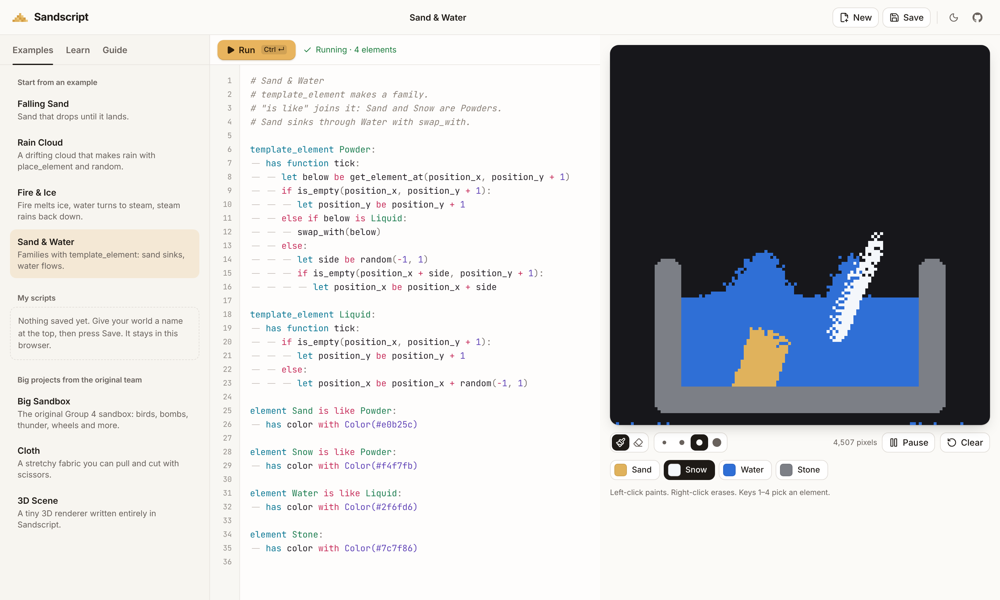

# Sandscript

**A tiny programming language for kids, with a falling-sand world that runs your code.**

Write a few lines of almost-plain English, press **Run**, and paint sand, water, fire and anything else you invent onto a live 128 × 128 grid. Every line you write changes what you see.



```
element Sand:
	has color with Color(#e0b25c)

	has function tick:
		if is_empty(position_x, position_y + 1):
			let position_y be position_y + 1
		else if chance(30):
			let side be random(-1, 1)
			if is_empty(position_x + side, position_y + 1):
				let position_x be position_x + side
```

## What's inside

- **Real programming ideas:** elements (classes), `template_element` and `is like` (inheritance), fields, functions with `needs` and `give`, `if / else if / else`, `go_through` and `for_every` loops, and `interaction` rules for when two elements touch.
- **Built-in helpers:** `random`, `chance`, `place_element`, `is_empty`, `get_element_at`, `convert_to`, `swap_with`, `spread_element`, `disappear`, `grid_width` and `grid_height`.
- **Learn tab:** a six-step tutorial that builds stone, sand, water, fire and steam, then the interactions between them.
- **Guide tab:** the whole language on one page, written for kids, with a tiny example for each idea.
- **Examples and saved scripts:** start from a preset, then save your own worlds in the browser.
- **Friendly errors:** compiler errors point at the line and say what to try, for example "Add a colon (:) at the end of this line."

## How it works

```
your code ─▶ ANTLR lexer + parser ─▶ AST ─▶ validator ─▶ builder ─▶ engine + interpreter ─▶ canvas
             (src/grammar, src/parser)     (src/ast)                (src/game)              (web worker)
```

Compiling happens in one web worker and the simulation runs in another, at 30 ticks per second, drawing straight to an `OffscreenCanvas`.

## Run it locally

```sh
bun install       # or npm install
bun run dev       # open the printed localhost URL
bun test          # 170+ tests: lexer, parser, AST, builder, interpreter, engine, presets
bun run build
```

`bun scripts/run-dsl.ts examples/falling-sand.sand 60 "Sand,20,0,6,6"` runs a program headlessly and prints the grid as text.

## Credits

Sandscript started as **UBC CPSC 410 Project 1, Group 4** (2026W T1). The language, parser, interpreter and engine were designed and built by the team:

- Stanley Cheung
- Harper Kim
- Alyson Kosek
- Jake Yeo
- Terence Yin ([@tyin76](https://github.com/tyin76))

The November 2026 polish pass (new interface, Learn and Guide tabs, presets, saved scripts, and the `random`, `chance`, `place_element`, `is_empty` and `swap_with` built-ins) was done by Jake Yeo with Claude. As the course required, AI-generated code is marked with `Start/End Code Generated by` comments. The original team programs live in `examples/` as Big Sandbox, Cloth and 3D Scene.
